# OPS AI 助手架构流程图（Mermaid 完整版）

> 基于现有架构 + 10 个功能增强

---

## 一、整体架构全景图

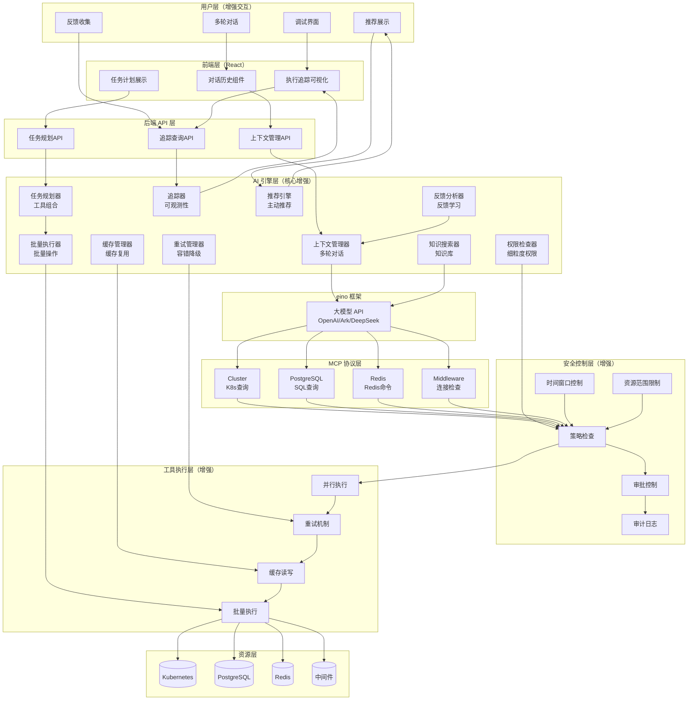

---

## 二、完整数据流图

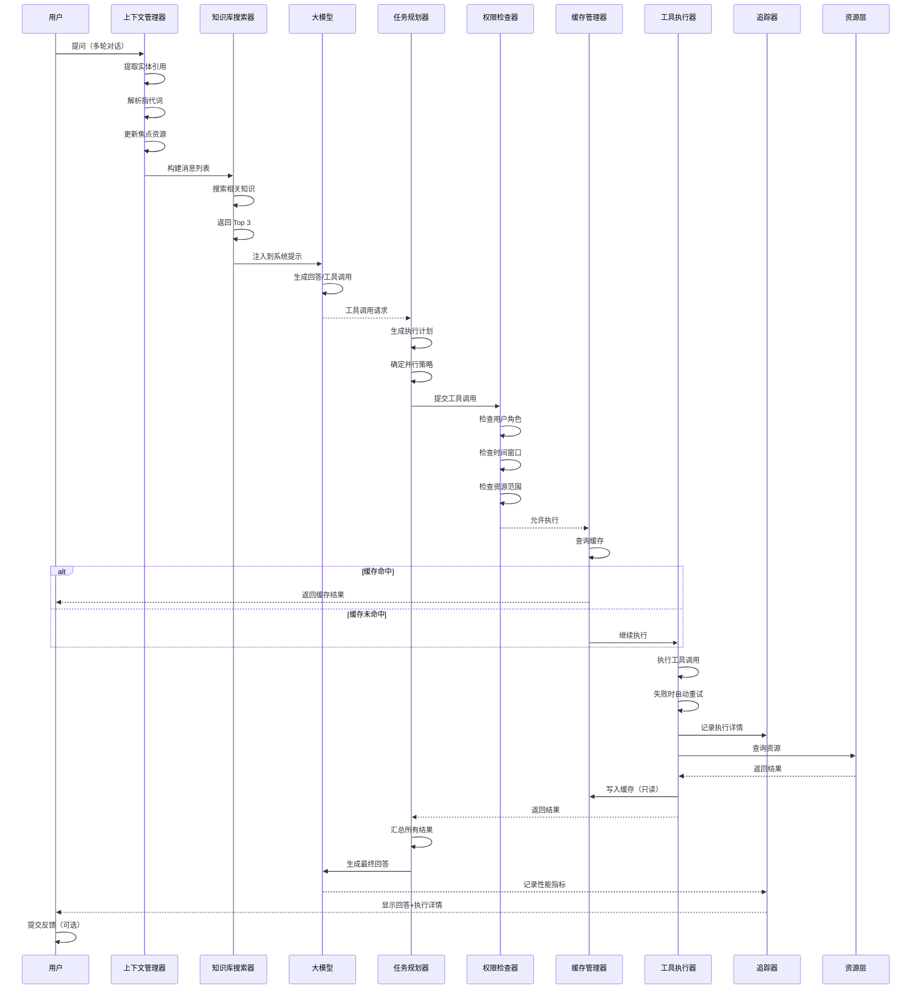

---

## 三、功能分层图

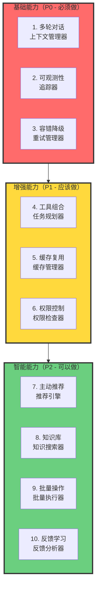

---

## 四、功能依赖关系图

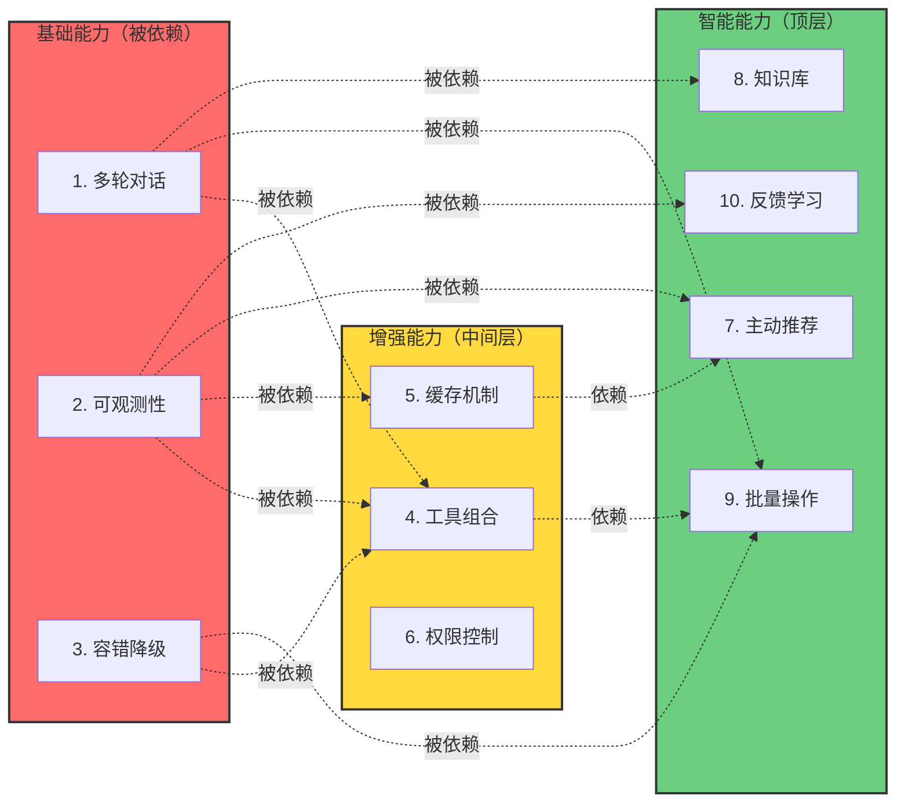

---

## 五、实施路线图

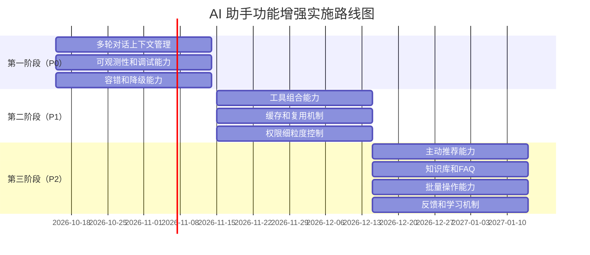

---

## 六、增强前 vs 增强后对比

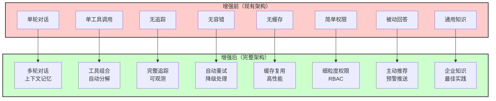

---

## 七、10 个功能详细架构图

### 7.1 多轮对话上下文管理

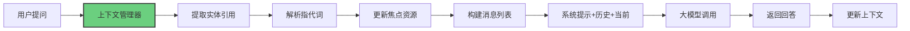

### 7.2 工具组合能力

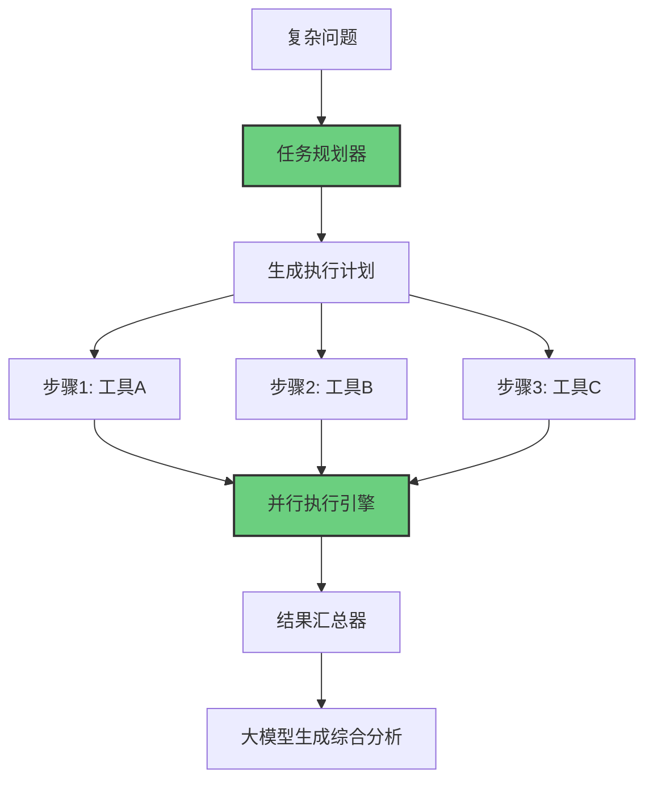

### 7.3 容错和降级能力

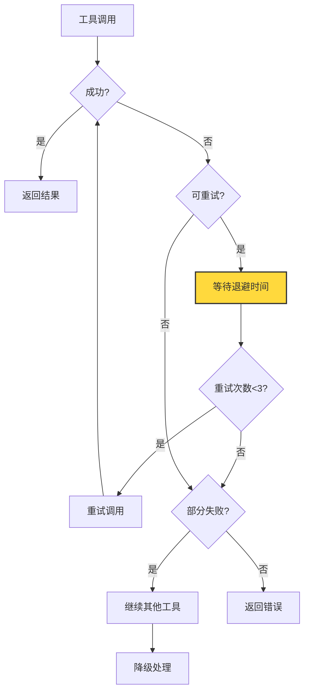

### 7.4 缓存和复用机制

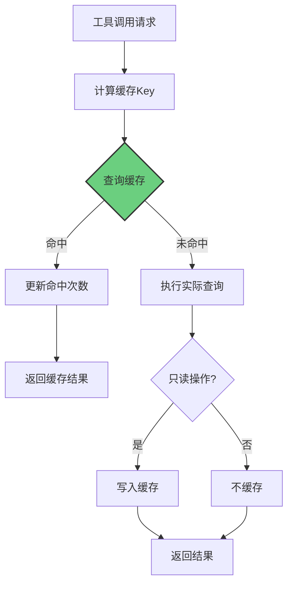

### 7.5 权限细粒度控制

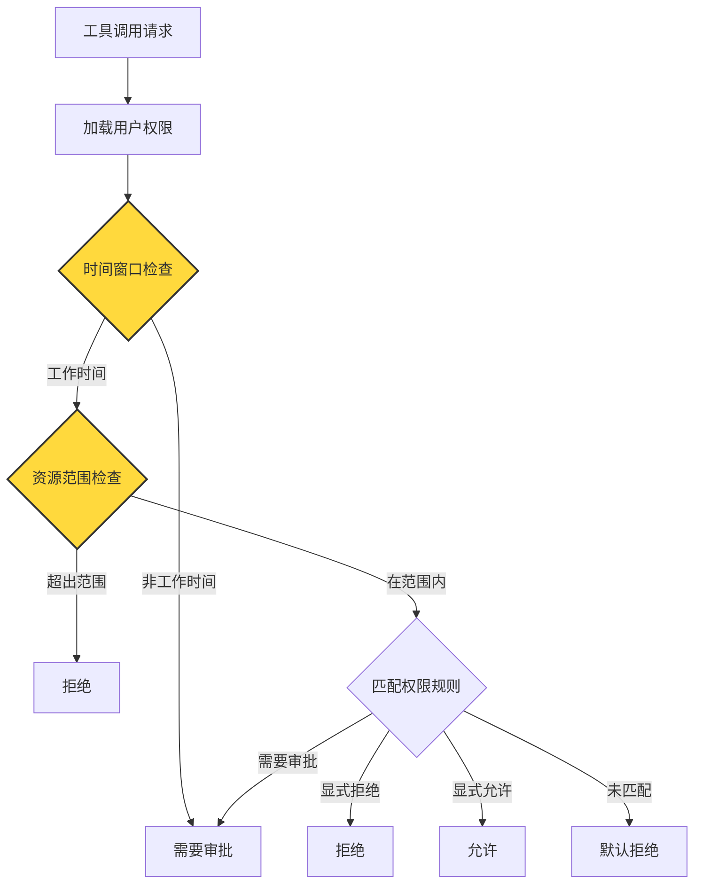

---

## 八、完整调用链路时序图

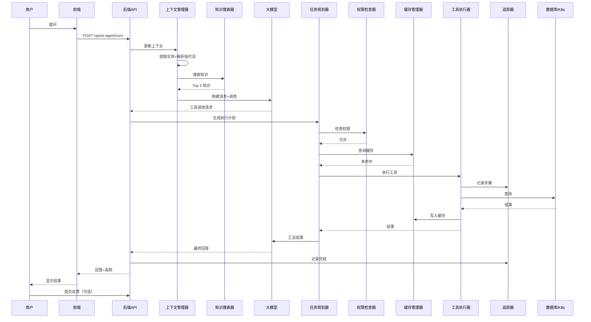

---

## 九、总结

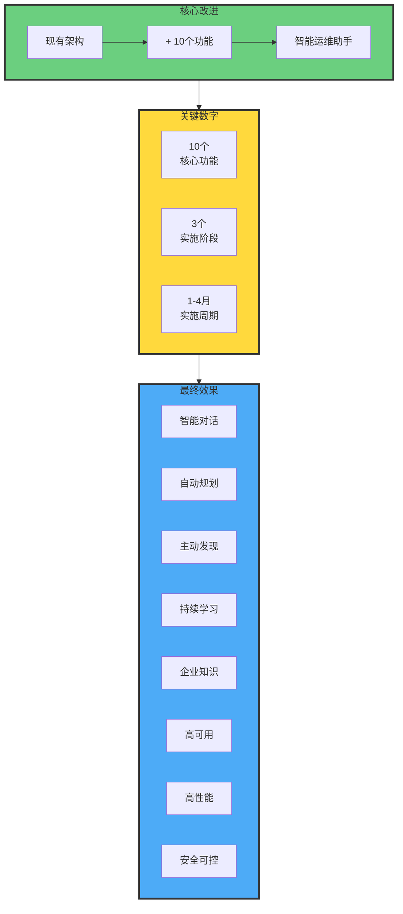

---

**这份 Mermaid 架构流程图完全基于现有架构，展示了 10 个功能增强的完整设计！**
