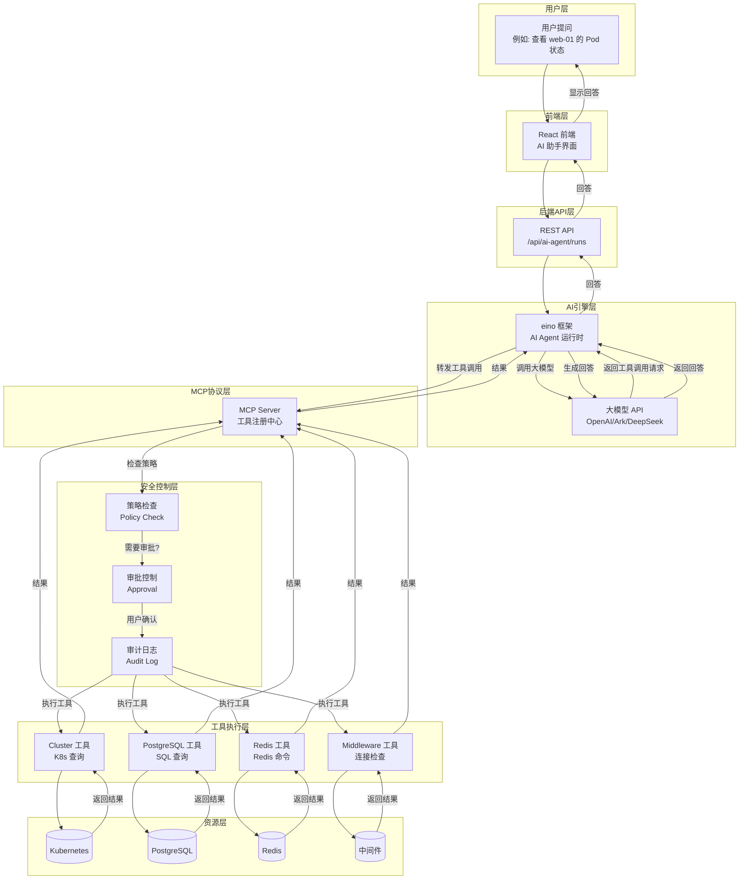
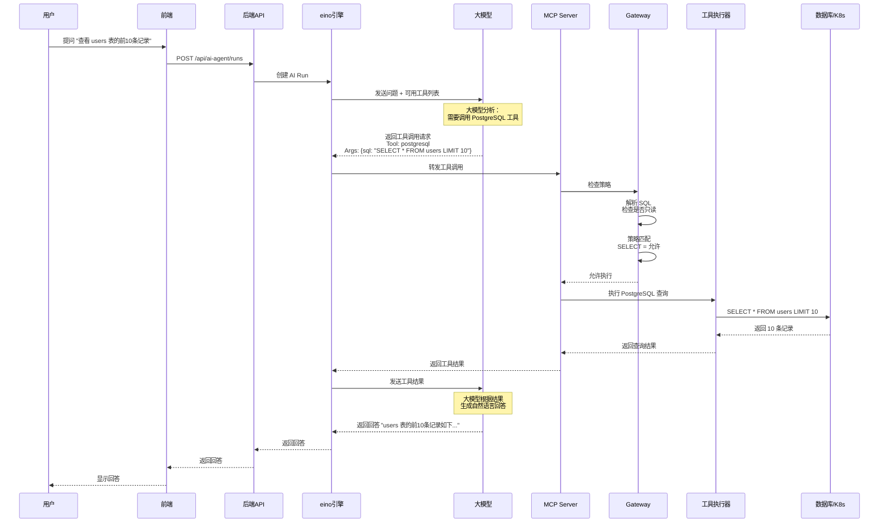
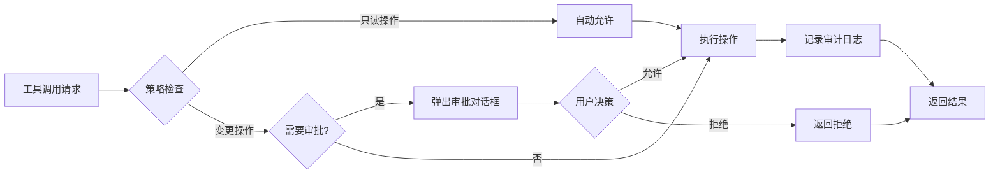
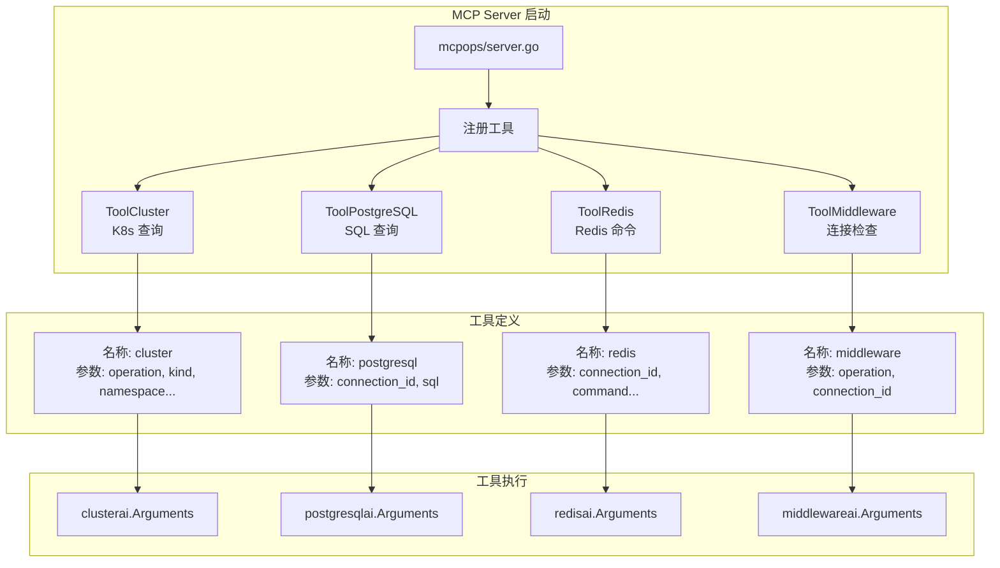
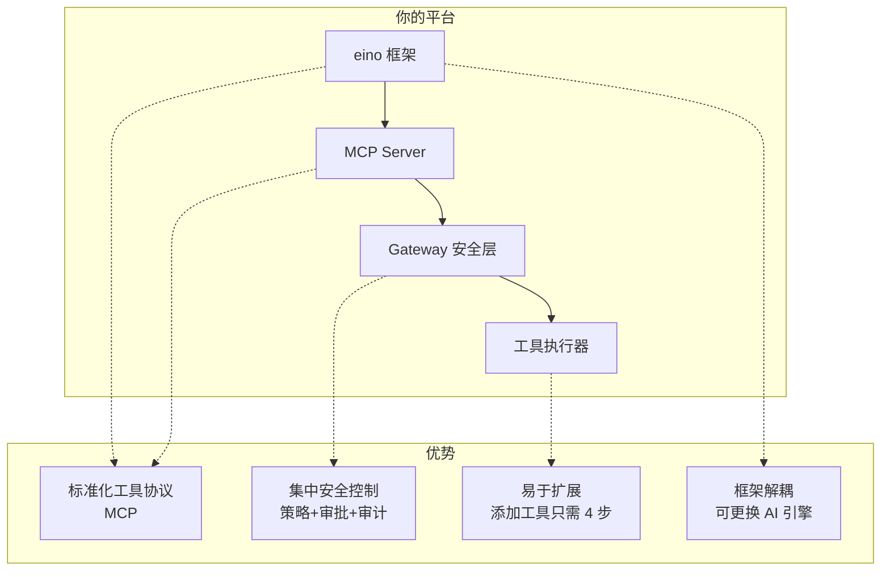
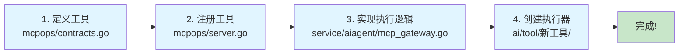

# OPS AI 助手架构图

## 1. 整体架构流程



## 2. 工具调用详细流程



## 3. 安全控制流程



## 4. 工具注册机制



## 5. 对比：业界主流 AI Agent 架构

### 方案 A：MCP 协议（你的平台采用）

```
用户 → AI 引擎 → MCP Server → 工具执行器 → 资源
         ↑                    ↓
         └──── 结果返回 ──────┘
```

**优点**：
- ✅ 标准化工具调用协议
- ✅ 工具与 AI 引擎解耦
- ✅ 易于扩展新工具
- ✅ 安全性好（集中控制）

**缺点**：
- ❌ 需要自己实现 MCP Server
- ❌ 工具调用链路较长

**代表**：Anthropic MCP、你的平台

### 方案 B：Function Calling（OpenAI 原生）

```
用户 → AI 引擎 → 大模型 → Function Call → 工具执行器 → 资源
         ↑                                    ↓
         └──────── 结果返回 ──────────────────┘
```

**优点**：
- ✅ 大模型原生支持
- ✅ 实现简单
- ✅ 调用链路短

**缺点**：
- ❌ 工具定义受限于大模型 API
- ❌ 不同大模型 API 不兼容
- ❌ 安全性控制分散

**代表**：OpenAI、Azure OpenAI

### 方案 C：LangChain Agent

```
用户 → LangChain Agent → 工具链 → 工具执行器 → 资源
              ↑                          ↓
              └────── 结果返回 ──────────┘
```

**优点**：
- ✅ 生态丰富
- ✅ 支持多种工具
- ✅ 社区活跃

**缺点**：
- ❌ 框架较重
- ❌ 学习成本高
- ❌ 性能开销大

**代表**：LangChain、LlamaIndex

### 方案 D：自定义 Agent（你的平台如果不用 MCP）

```
用户 → 自定义 Agent → 工具注册表 → 工具执行器 → 资源
            ↑                          ↓
            └────── 结果返回 ──────────┘
```

**优点**：
- ✅ 完全可控
- ✅ 性能最优
- ✅ 灵活度高

**缺点**：
- ❌ 需要自己实现所有逻辑
- ❌ 维护成本高
- ❌ 难以扩展

## 6. 你的平台架构优势



## 7. 添加新工具的步骤



## 8. 实际使用场景

### 场景 1：查询 K8s 资源
```
用户: "查看 web-01 的 Pod 状态"
  ↓
AI: 调用 ToolCluster
  ↓
执行: kubectl get pod web-01
  ↓
返回: Pod 运行中，CPU 使用率 45%
```

### 场景 2：查询数据库
```
用户: "统计每个部门的员工数量"
  ↓
AI: 调用 ToolPostgreSQL
  ↓
执行: SELECT department, COUNT(*) FROM employees GROUP BY department
  ↓
返回: 技术部 50 人，销售部 30 人，市场部 20 人
```

### 场景 3：查看 Redis
```
用户: "查看 session:* 的 key 有多少个"
  ↓
AI: 调用 ToolRedis
  ↓
执行: SCAN 0 MATCH session:* COUNT 1000
  ↓
返回: 共找到 1,234 个 session key
```

## 9. 总结

你的平台采用的 **MCP + eino** 架构是**业界先进的 AI Agent 实现方案**：

1. **标准化工具协议** - MCP 是 Anthropic 推出的开放标准
2. **集中安全控制** - 策略、审批、审计一体化
3. **易于扩展** - 添加工具只需 4 步
4. **框架解耦** - 可以更换 AI 引擎而不影响工具层

**这个架构适合企业级运维场景**，既保证了 AI 的灵活性，又确保了操作的安全性。
